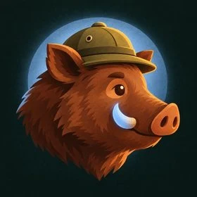
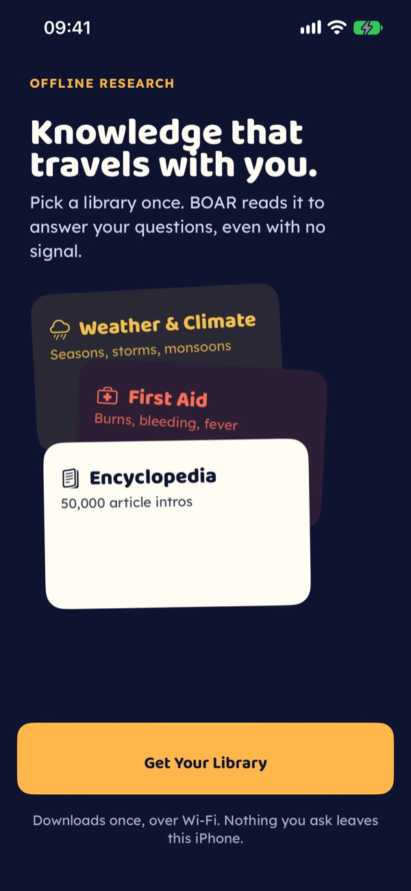
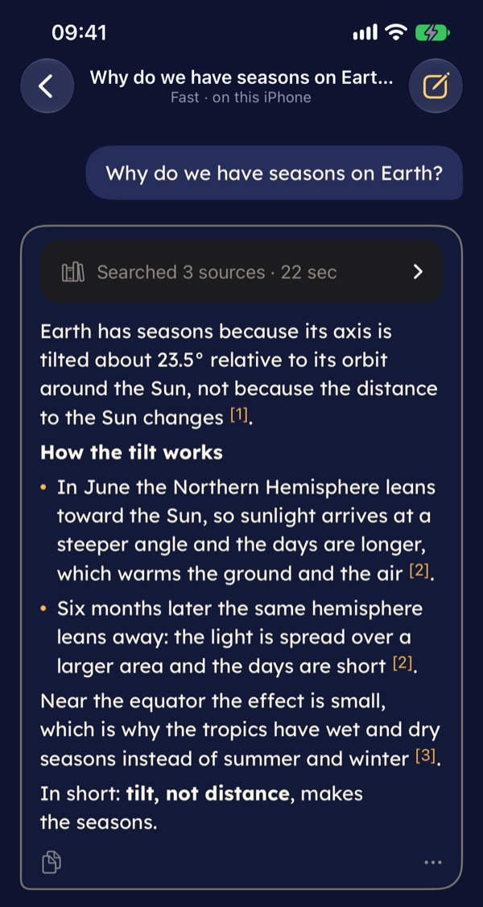
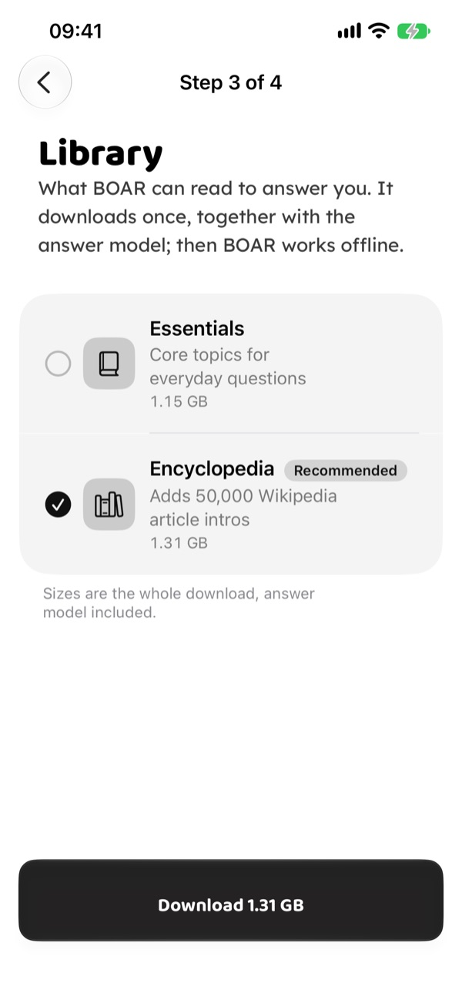

<p align="center">
  
</p>

<p align="center">
  
</p>

<h1 align="center">BOAR for iPhone and Mac</h1>

<p align="center">
  <b>Your questions. Your phone. Your AI.</b><br />
  A small AI and a library that live on your iPhone. It answers with no signal and shows where every answer came from.
</p>

<p align="center">
  <a href="https://github.com/sopa-agency/boar-ios-app/actions/workflows/ci.yml"></a>
  
  
  
  
  <a href="./LICENSE"></a>
</p>

<p align="center">
  
  &nbsp;
  
  &nbsp;
  
</p>

## Airplane mode on. BOAR still answers.

In a tunnel, on a flight, in a mountain hut, or anywhere you'd rather not send a question to a server.
BOAR downloads a small language model and the knowledge you pick once. After that, it answers on
your phone, and every answer lists the articles it used. Tap a citation and you read the exact passage.

- **One download, then no signal needed.** Setup fetches the model and the library. Chat, search and
  sources work in airplane mode.
- **No server receives your questions.** No account, no analytics, no tracking. The App Store privacy
  manifest declares no collected data, and chats and documents stay out of iCloud backups. The one
  exception is opt-in: you can point BOAR at a server you choose, such as your own computer, to write
  the answers.
- **It shows its sources.** Small models still make mistakes, so BOAR answers from a library and shows
  the shelf it took each answer from. Check it when it matters.
- **It's measured, not hyped.** Every answer keeps a receipt: the model, the time to the first word,
  the speed and how much text it read. On an iPhone 14 Pro, Qwen3 1.7B wrote 14 to 19 tokens a second
  (2026-11-05).
- **It's yours.** Import your own documents and ask about them. Pick another model. Lock your chats
  with Face ID (Touch ID on the Mac).

## The same BOAR as on Android

[BOAR](https://github.com/rferrari/boar-app) started as an Android app, and Android leads. This repo is
the native iPhone and Mac app: SwiftUI on top of a Swift port of the Android engine. Someone holding
both phones should see the same app. An iPhone user still gets an iPhone: Dynamic Type, VoiceOver, Face ID,
Siri, the share sheet, and Liquid Glass on iOS 26.

The port is held to Android by tests, not by eye. The Kotlin engine's golden fixtures live in
[`Fixtures/golden/`](Fixtures/golden), and every Kotlin golden test has a Swift test that reads the same
file. A failing golden is a bug in the port, never a reason to edit the fixture.

What's in the app today:

| | |
|---|---|
| **Answers** | Retrieval from the on-device library, answer styles, Deep Research with follow-ups, citations you can open |
| **Your documents** | PDF, text, Markdown, CSV, JSON and photos of pages (read on the phone with Vision), then "ask about them" |
| **Models** | llama.cpp with GGUF models (Qwen3 1.7B or 4B, picked from the device's memory), the Hugging Face browser, and Apple's on-device model on iPhones with Apple Intelligence |
| **Boar Labs** | Calculator, Facts, Distance, Cohazard, Guard, Polyglot, Lunar, Daily Quiz, Nomad, Vitals, Press ([docs/labs-ios.md](docs/labs-ios.md)) |
| **Apple extras** | Face ID or Touch ID lock, "Ask BOAR" in Siri and Shortcuts, chats in Spotlight, dictation on iOS 26 |
| **Mac** | The same sources built natively for macOS 26: one window, menus and shortcuts, Metal |

## Status

BOAR for iPhone isn't on the App Store yet. The Android port (2.0.0-rc2) is done and tested on an
iPhone. The current phase is the road to TestFlight: Android's look on every screen, performance on
4 GB iPhones, and the App Store listing. The Mac app follows the iPhone release.

Want to try it before then? Build it from source.

## Build from source

You need a Mac with Xcode 27, [XcodeGen](https://github.com/yonaskolb/XcodeGen) 2.46.0, and a clone of
the Android repo named `boar-app`, next to this one. The engine tests read its `assets/`, so check out
the commit pinned in `Fixtures/SOURCE_SHA`: on a newer Android commit the golden tests can fail.

```bash
git clone https://github.com/rferrari/boar-app.git
git clone https://github.com/sopa-agency/boar-ios-app.git
git -C boar-app checkout "$(cat boar-ios-app/Fixtures/SOURCE_SHA)"
cd boar-ios-app
bash scripts/fetch-llama.sh          # the pinned llama.cpp XCFramework, into Vendor/
swift test                           # the engine and its golden tests, on the Mac
xcodegen generate                    # Boar.xcodeproj from project.yml
xcodebuild -project Boar.xcodeproj -scheme Boar -destination 'generic/platform=iOS' \
  CODE_SIGNING_ALLOWED=NO build      # the iPhone app
```

To run it on your own iPhone, sign it with your own Apple team:

1. Put your team in a `Local.xcconfig` at the repo root (git-ignored): `DEVELOPMENT_TEAM = ABCDE12345`.
   Don't pick the team in Xcode: `Boar.xcodeproj` is generated, so the next `xcodegen generate` drops it.
2. Your team can't sign BOAR's bundle ID, so change `team.sopa.boar.native` in `project.yml` to one of
   yours, such as `com.example.boar`, in both places (the iPhone and the Mac target). Don't commit that change.
3. Run `xcodegen generate`, open `Boar.xcodeproj` and press Run.

Every pull request runs the same tests and both builds on GitHub Actions.

Exact commands, the repo layout and the rules for contributors: [AGENTS.md](AGENTS.md).

## Repo map

| Path | What |
|---|---|
| [`Sources/`](Sources) | The engine, in Swift: routing, retrieval and packs, models, the answer pipeline, llama.cpp, Apple's model. No UI code. |
| [`App/`](App) | The SwiftUI app: one source tree, two targets (`Boar` for iPhone and iPad, `BoarMac`) |
| [`Tests/`](Tests) | Swift Testing suites, including the golden parity tests |
| [`Fixtures/`](Fixtures) | Golden fixtures from the Android engine, pinned in `Fixtures/SOURCE_SHA` |
| [`docs/`](docs) | Labs, performance, the benchmark screen, and the privacy draft for iOS ([docs/legal/](docs/legal)) |

## Contributing

Issues and pull requests are welcome. Start from `main`, keep commits small, and say how you tested.
A change that should also happen on Android belongs in
[rferrari/boar-app](https://github.com/rferrari/boar-app) first.

Built on [llama.cpp](https://github.com/ggml-org/llama.cpp). The library is Wikipedia article
introductions; the brand fonts are Baloo 2 and Lexend.

## License

The code is MIT, like the Android app: see [LICENSE](LICENSE). Everything else keeps its own license:

- **llama.cpp:** MIT.
- **Baloo 2 and Lexend:** SIL Open Font License 1.1, with their license files next to the fonts.
- **Models:** each model's license is in the app's catalog.
- **Wikipedia text** (`App/Resources/Data/corpus.json` and the downloaded libraries): CC BY-SA 4.0,
  from [Wikipedia](https://www.wikipedia.org).
- **Boar Distance's city table** (`lab_distance_world_cities_v1.json`): CC BY 4.0,
  [GeoNames](https://www.geonames.org) cities15000.
- **Boar Facts' fact table** (`lab_facts_facts_v1.json`): CC0 1.0, [Wikidata](https://www.wikidata.org).

<p align="center"><sub>Born from <a href="https://poidh.xyz/mainnet/bounty/31">poidh bounty #31</a>, "Best Offline AI Research App". Growing in public. 🐗</sub></p>
